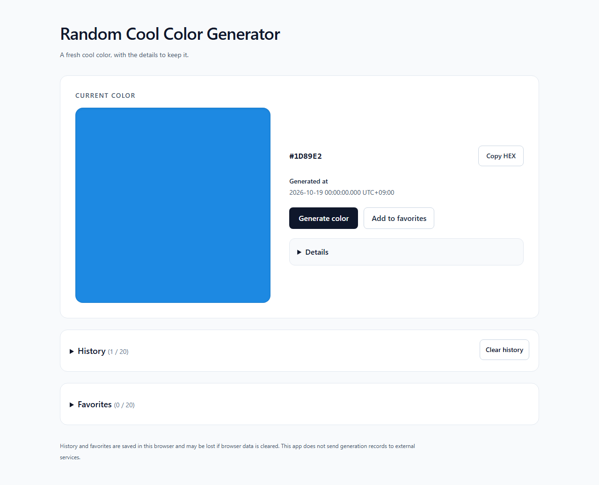
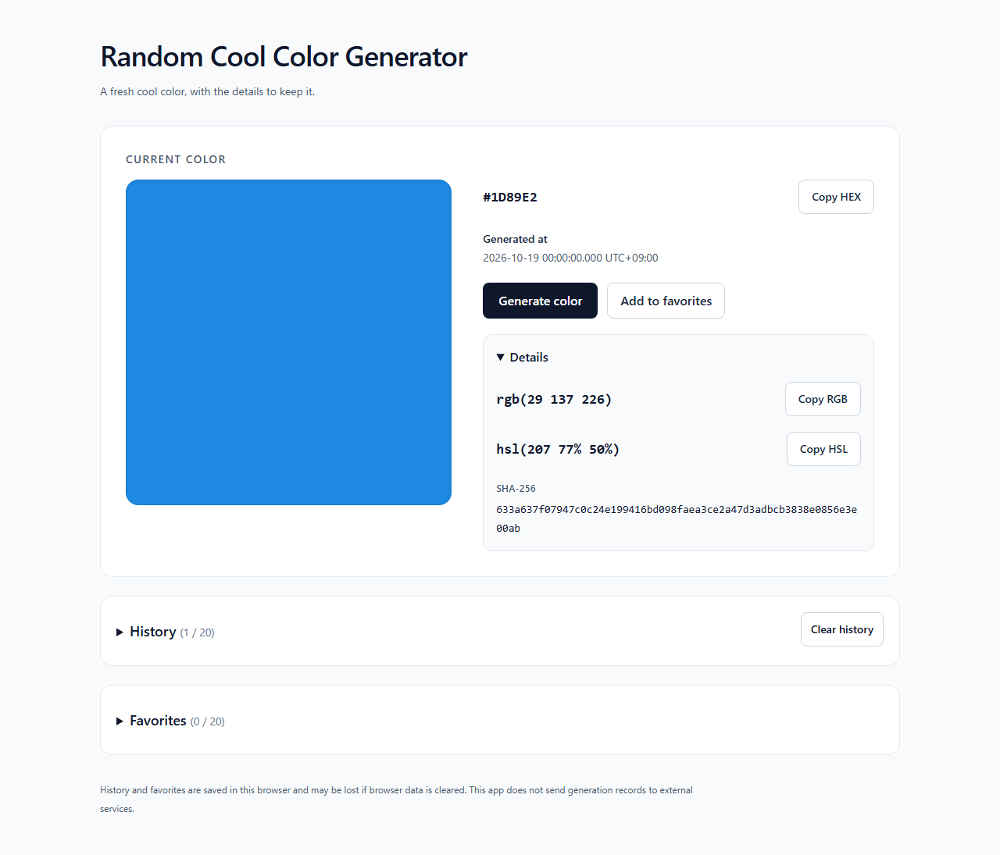
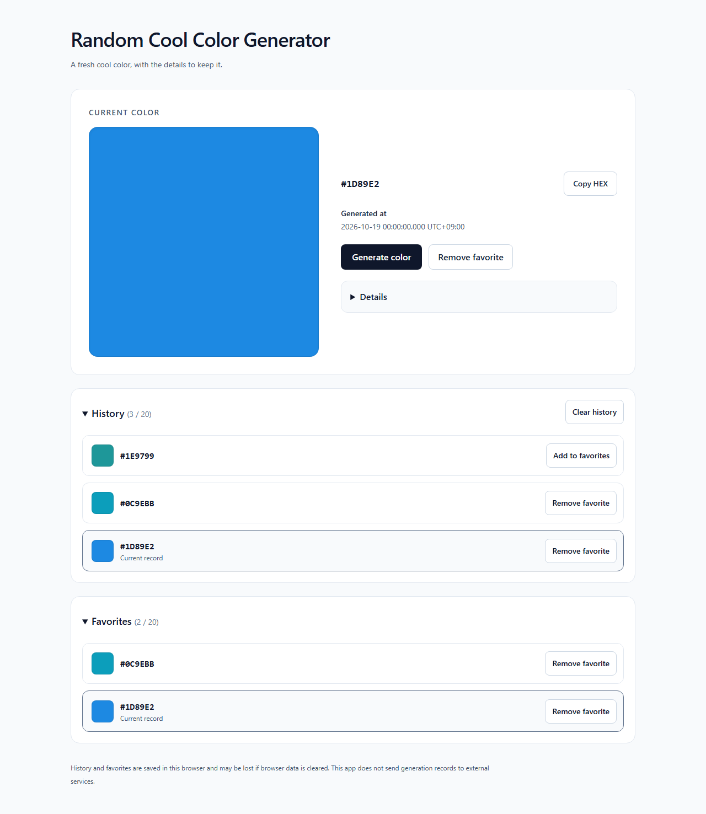

# Random Cool Color Generator

<p>
  <a href="https://seiya-matsuoka.github.io/random-cool-color-generator/">
    
  </a>
</p>
<p>
  
  
  
  
</p>
<p>
  
  
  
  
</p>

小さなフロントエンドアプリを題材に、AI エージェントを活用した開発の一連の流れと、初めて扱う技術・開発手法を実践するために取り組んだ個人開発プロジェクト。
Codex を活用して企画・要件整理・設計・実装・レビュー・検証・文書化を進め、人が目的や仕様、重要な判断、成果物の確認、Git・GitHub 操作を担う形で開発した。

アプリは、生成時点の日時と連番を入力に、SHA-256 から寒色を求める 1 ページの Web アプリケーション。
HEX / RGB / HSL の確認・コピーと、履歴・お気に入りの保存・再表示をブラウザ内で利用できる。

---

## このリポジトリの位置づけ・学習目的

React / TypeScript による小規模なアプリ開発を通して、AI エージェントへの作業の任せ方と、実装・品質確認・公開をつなぐ開発方法を実践することを目的とした。
特定の業務用途や利用者像は設定せず、フロントエンドだけで完結する題材で、次の内容に取り組んだ。

- **AI エージェントを活用した開発**  
  対話で目的・要件・設計・工程を具体化し、事前確認、開始指示、実装・検証、レビュー・修正をフェーズごとに繰り返す。
- **責務を分けた実装**  
  UI、画面状態と非同期処理の調整、色の生成・記録操作、ブラウザ保存を分け、処理と検証対象を対応させる。
- **目的に応じた品質確認**  
  単体テスト、E2E、coverage、axe、Storybook を使い分け、正常系だけでなく境界条件・保存失敗・確認のキャンセル・タブ間更新などを扱う。
  一部のロジックでは、テストを先に用意し、未実装の失敗から実装後の成功までを確認する方法も試した。
- **Git・GitHub と CI/CD**  
  Issue、branch、目的ごとの commit、PR、CI、merge を使い、品質確認した配信物を GitHub Pages へ公開する流れを扱う。
- **ソースコードとテストコードのコードリーディング**  
  処理・設計・検証の意味を追えるよう、日本語コメントを記載する。
  主要な型・関数の責務や失敗時の扱い、テストの準備・実行・検証、固定値・境界値・依存先の置き換えの意図を説明する。

Storybook は、今回初めて扱う UI の独立確認の手段として採用した。

---

## 開発の進め方

### 人と Codex の役割

| 作業                   | 人                                                                            | Codex                                                      |
| ---------------------- | ----------------------------------------------------------------------------- | ---------------------------------------------------------- |
| 目的・仕様・設計・範囲 | 目的を共有し、重要な判断を行う                                                | 調査、具体案、選択肢、影響を整理する                       |
| フェーズごとの作業     | 対象範囲を確認して開始を指示し、成果物をレビューする                          | 許可された範囲の実装・検証・修正と文書作成を行う           |
| 表示・操作の確認       | 意図や操作感との一致を確認する                                                | 自動検査やブラウザでの確認を行い、確認範囲と残件を報告する |
| Git・GitHub            | Issue / branch / staging / commit / push / PR / merge / GitHub 設定を操作する | 読み取り専用の状態確認、文案、レビューを担当する           |

### フェーズごとのサイクル

1. 現在の実装・文書・Git 状態を確認し、対象フェーズの計画と完了条件を具体化する。
2. 人が計画を確認し、作業範囲を指定して開始を指示する。
3. Codex が実装・検証し、変更内容、結果、未実施項目を報告する。
4. 成果物をレビューし、必要な修正と再確認を行う。
5. 人が Git・GitHub 操作を進め、対象フェーズを区切って次の依頼へ進む。

不具合の確認では、再現する条件をテストへ落とし込み、修正後も同じ条件で確認する方法を取り入れた。
コードコメントには、処理の読み上げだけでなく、仕様との対応、採用理由、非同期処理や失敗時の注意点を残している。

Git・GitHub の基本の流れは次のとおり。

```text
Issue → 作業 branch → 目的ごとの commit → PR → CI・差分レビュー → main へ merge
```

原則として 1 Issue / 1 branch / 1 PR とし、commit は Conventional Commits と簡潔な日本語の件名を使用する。
merge は `Create a merge commit` を使い、branch 上の各 commit を保持する。

---

## 公開 URL

[](https://seiya-matsuoka.github.io/random-cool-color-generator/)

[Random Cool Color Generator を開く](https://seiya-matsuoka.github.io/random-cool-color-generator/)

GitHub Pages で公開している。
アカウント登録やログインは不要で、画面を開いてそのまま利用できる。

---

## スクリーンショット

固定データによる PC 幅の画面例。

1. 初回生成後の通常画面

   色見本、HEX、生成日時、生成・お気に入り操作を表示する。
   `Details`、`History`、`Favorites` は初期状態では閉じている。

   

2. Details を開いた画面

   RGB / HSL の表示・コピー操作と、SHA-256 の全文を確認できる。

   

3. 履歴・お気に入りを開いた画面

   履歴 3 件・お気に入り 2 色を表示した例。
   元の生成記録の再表示、現在の選択、お気に入り登録状態を確認できる。

   

---

## できること・基本的な使い方

| 機能                 | 内容                                                                                   |
| -------------------- | -------------------------------------------------------------------------------------- |
| 寒色の生成           | 初回表示時と `Generate color` 操作時に、緑寄りのシアンから青・青紫までの寒色を生成する |
| 生成情報の表示       | 色見本、HEX、生成日時を表示し、`Details` で RGB / HSL / SHA-256 を確認する             |
| カラーコードのコピー | HEX / RGB / HSL を CSS で使える形式で個別にコピーする                                  |
| 履歴                 | 直近 20 件の生成記録を保存し、選択した元の色・日時・詳細を再表示する                   |
| お気に入り           | 最大 20 色を保存し、履歴から消えた後も元の生成記録を再表示する                         |
| 確認付きの削除       | 履歴の全件削除と、お気に入りの解除を確認ダイアログで行う                               |
| タブ間の更新         | 正常に保存できる状態では、同じ保存領域を使う別タブの変更を一覧へ反映する               |

基本的な操作は次のとおり。

1. 公開 URL を開き、最初に生成された色を確認する。
2. `Generate color` で次の色を生成する。
3. `Copy HEX` で HEX をコピーする。
   RGB / HSL は `Details` を開いてコピーする。
4. `History` を開き、過去の記録を選択して再表示する。
5. `Add to favorites` で登録し、`Favorites` から再表示する。
6. 履歴の削除は `Clear history`、お気に入りの解除は `Remove favorite` を使い、確認内容を確認して実行する。
   `Cancel` または Escape でキャンセルできる。

履歴・お気に入りの選択では、新しい色の生成や履歴の追加・並べ替えを行わない。
履歴の削除やお気に入りの解除後も、現在表示している色は保持する。
コピーに失敗した場合は、画面のコードを選択して手動でコピーできる。

生成は日時とページ内の連番を入力とする。
直前と同じ HEX の候補は再試行するが、過去のすべての生成結果との一意性を保証するものではない。
生成範囲・変換式・再試行の詳細は [完成後の技術設計](docs/after-development/03-technical-design.md#3-色の生成) を参照。

---

## データの保存について

履歴・お気に入りは、利用中のブラウザの `localStorage` に別々に保存する。
サーバー保存やアカウント間の同期は行わない。

- **履歴は直近 20 件**を保持し、超過分は古いものから除外する。
- **お気に入りは HEX ごとに最大 20 色**を保持する。
  同じ HEX は二重登録せず、上限に達したら新規登録を止める。
  空きを作るための自動削除は行わない。
- ブラウザを閉じた後も通常は利用できるが、ブラウザのデータ削除・設定・プライベートブラウジングなどで失われる場合がある。
  長期保存は保証しない。
- 履歴を保存できない場合も、そのタブ内では直近 20 件を利用できる。
  再読み込み後の保持は保証せず、通常の保存は再読み込みまで再試行しない。
- お気に入りは保存に成功した更新だけを画面へ反映する。
  保存に失敗した追加・解除は反映しない。
- 全体を読み込めない破損・未対応データは保護し、無断で上書き・削除しない。
  対象を明示した `Reset history` / `Reset favorites` を確認後に実行できる。
  保存領域を利用できない場合は、ブラウザ設定の確認や再読み込みを案内する。

アプリの色生成・保存処理から、生成記録を外部サービスや URL へ送信・付加しない。
解析、外部エラー収集、実行時の外部フォント・スクリプト CDN は使用していない。
ページや静的ファイルの取得には通信が発生する。

保存値の検証、一部不正な記録の扱い、保存キー、リセット、タブ間更新の詳細は [完成後の技術設計](docs/after-development/03-technical-design.md#5-保存データの検証と失敗時の動作) を参照。

---

## 技術スタック

| 用途                 | 技術・ツール                   | 役割                                                                                     |
| -------------------- | ------------------------------ | ---------------------------------------------------------------------------------------- |
| UI・画面状態         | React / TypeScript             | UI、props、記録・処理結果の型、状態と非同期処理の調整                                    |
| 開発・ビルド         | Vite / Node.js / npm           | 開発サーバー、本番ビルド、preview、開発用コマンドの実行                                  |
| スタイル             | Tailwind CSS v4                | 中立色を基調とした画面、レスポンシブ表示、フォーカスなどのスタイル                       |
| 生成・保存           | Web Crypto API / localStorage  | SHA-256 による色生成、ブラウザ内の記録保存。保存値は実行時にも検証する                   |
| 整形・静的検査       | Prettier / ESLint / TypeScript | 書式、コード品質、型の整合の確認                                                         |
| 単体テスト・coverage | Vitest / V8 coverage           | 生成・変換・記録操作・保存などの境界条件と失敗の確認、対象ロジックの未確認箇所の把握     |
| ブラウザテスト       | Playwright / axe               | 本番ビルドの利用フロー・保存異常・タブ間更新などと、代表状態のアクセシビリティの自動検査 |
| UI の独立確認        | Storybook                      | 固定 props とコールバックによる状態の再現、Docs / Controls / Actions での確認            |
| CI・公開             | GitHub Actions / GitHub Pages  | 品質確認から検証済み成果物の保存・公開への接続                                           |

UI は表示用の props とコールバックを受け取り、hook が画面状態と非同期処理を調整する。
生成・変換・記録操作・保存とその検証は、UI から分けている。
バックエンド、DB、外部 API、追加の状態管理・ルーティング・保存ライブラリは使用していない。

依存の指定版は [package.json](package.json)、解決結果は [package-lock.json](package-lock.json) を参照。

---

## 前提環境・ローカル起動

### 前提環境

- Node.js 24.16.0  
  [.node-version](.node-version) で指定し、CI も同じファイルを参照する。
  `package.json` の対応範囲は Node.js 24 系。
- npm
- Chromium 系ブラウザ  
  自動 E2E は Playwright が管理する Chromium を使用する。

以降のコマンドはリポジトリのルートで実行する。
PowerShell で `npm.ps1` の実行が制限される場合は、`npm` を `npm.cmd` に置き換える。

### 初回の準備

リポジトリを取得し、ルートへ移動する。

```bash
git clone https://github.com/seiya-matsuoka/random-cool-color-generator.git
cd random-cool-color-generator
```

Node.js / npm のバージョンを確認する。

```bash
node --version
npm --version
```

ローカルの npm cache・ログは、プロセス環境の `NPM_CONFIG_CACHE` でリポジトリ内の `.npm-cache` へ向ける。
PowerShell の設定例は次のとおり。
新しいターミナルでは再設定し、他の Shell では対応する環境変数の構文を使う。

```powershell
$env:NPM_CONFIG_CACHE = Join-Path (Get-Location) '.npm-cache'
```

lock ファイルに基づいて依存関係を取得する。

```bash
npm ci
```

E2E を実行する場合は、初回に Chromium を取得する。
依存関係とブラウザの取得にはネットワーク接続が必要となる。
通常の起動・検証のたびに取得し直す必要はない。

```bash
npm run e2e:install
```

アプリ用の環境変数、API キー、DB の準備は不要。

### 開発サーバー

```bash
npm run dev
```

開く URL：`http://127.0.0.1:5173/random-cool-color-generator/`

### 本番 build・preview

```bash
npm run build
npm run preview
```

開く URL：`http://127.0.0.1:4173/random-cool-color-generator/`

Vite の `base` は `/random-cool-color-generator/` とする。
開発サーバーと preview は port を固定し、使用中の場合に別の port へ自動で切り替えない。
起動したサーバーは Ctrl+C で終了する。

---

## 品質確認・テスト・Storybook

### 確認コマンド

静的検査と単体テスト・coverage をまとめて実行する。

```bash
npm run check
```

アプリ・Storybook の build と E2E まで含めて確認する。
E2E 用 Chromium は、初回の準備で取得しておく。

```bash
npm run verify
```

| コマンド                  | 内容                                                     |
| ------------------------- | -------------------------------------------------------- |
| `npm run check`           | format check → lint → type check → 単体テストと coverage |
| `npm test`                | 単体テストを 1 回実行                                    |
| `npm run test:watch`      | 単体テストの watch 実行                                  |
| `npm run test:coverage`   | 単体テストと V8 coverage の text / HTML レポート作成     |
| `npm run test:e2e`        | 本番 E2E → 開発時ライフサイクルの補助検証                |
| `npm run test:e2e:ui`     | 本番用設定で Playwright の UI mode を起動                |
| `npm run storybook`       | Storybook の開発サーバーを起動                           |
| `npm run build-storybook` | Storybook の静的 build                                   |
| `npm run verify`          | check → アプリ build → Storybook build → E2E             |

個別の E2E / UI mode は、ビルド済みの `dist` を前提にする。
単独で実行する場合は、先にアプリを build する。

```bash
npm run build
npm run test:e2e
```

`test:e2e` と `verify` は、本番 preview と開発時の補助検証用サーバーを起動する。
事前に開発サーバー・preview を終了し、4173 / 5173 を空けておく。
既存の不明なサーバーは再利用しない。
本番 E2E の baseURL は `http://127.0.0.1:4173/random-cool-color-generator/`。

### 確認対象の使い分け

- **単体テスト**  
  既知値、色変換、再試行、履歴・お気に入りの上限と重複、保存値の検証、保存例外などを確認する。
  日時や依存先を固定・置換し、偶然のランダム結果に依存させない。
- **coverage**  
  集計対象は `src/lib` のロジックであり、未 import の対象も含める。
  hook・UI・ブラウザ統合全体の網羅率ではなく、UI の操作可否を扱う単体テストも集計対象には含めない。
  レポートは `coverage/index.html` から確認できる。
- **E2E**  
  本番 build を Chromium のデスクトップ幅・モバイル幅で配信・操作し、生成、コピー、保存、再表示、確認、異常系、タブ間更新などを確認する。
  開発時の Strict Mode・多重実行・unmount 後の結果は、別の補助 runner で確認する。
  モバイル幅の検証は、スマートフォン実機や他のブラウザでの互換性の保証を示すものではない。
- **axe と人による確認**  
  代表状態のアクセシビリティを自動検査し、自動判定できない項目は違反と分けて扱う。
  キーボード操作・フォーカスの操作検証に加え、見た目や操作感は別に確認する。
  自動検査の成功を、読み上げ・実機を含む人による確認と同じ意味には扱わない。

テストは専用の固定データと独立したブラウザコンテキストを使い、利用者の実データを使わない。
検証設計と個別 scripts の詳細は [完成後の技術設計](docs/after-development/03-technical-design.md#8-テストと-storybook-の設計) を参照。

### Storybook の使い方

```bash
npm run storybook
```

開く URL：`http://127.0.0.1:6006/`

色表示、一覧、通知、確認ダイアログなどを、空・通常・上限・処理中・保存不可・破損保護の状態で独立して確認できる。
Docs でコンポーネントの情報を読み、Controls で props を変更し、Actions で操作要求と引数を観察する。

Story は固定 props とモックのコールバックを使用し、実際の生成・保存 hook には接続しない。
データ処理や画面全体の統合は単体テスト・E2E が担当する。
Interaction tests、Chromatic、Storybook の外部公開は導入していない。

既存の起動スクリプトが、Storybook の実行前から telemetry を無効化する。
通常の起動・build で手動の環境変数設定は不要。
静的 build の出力先は `storybook-static`。

---

## CI・GitHub Pages 公開

GitHub Actions は、`main` 向け PR と `main` への push で `verify` ジョブを実行する。
Node.js は `.node-version` を参照し、`npm ci`、Chromium と runner 用 OS 依存の導入、`npm run verify` の順に進む。
文書だけの変更でも品質確認を実行する。

```text
main 向け PR：verify → 品質確認・レビュー

main push：verify → 検証した同じ dist を artifact 化 → deploy → GitHub Pages
```

Pages 用 artifact は、品質確認に成功した `main` push で作成する。
公開 job はその artifact を使用し、公開直前に別の build を作らない。
PR からは公開しない。

公開処理は直列化し、進行中の公開を新しい push で中断しない。
公開開始時に現在の `main` と実行対象の commit を照合し、古い実行による公開を避ける。
公開先は GitHub Pages の `github-pages` environment とし、必要な公開権限は公開 job に限定する。

公開対象はアプリの `dist` であり、Storybook、coverage、テストレポート、補助 harness は含めない。
ブラウザ検証の失敗時は、テスト用データだけを含むレポート・trace を artifact に残す。
公開開始後の `main` 更新は、品質確認に成功すると再公開へつながる。

定義は [.github/workflows/ci.yml](.github/workflows/ci.yml)、構成の詳細は [完成後の技術設計](docs/after-development/03-technical-design.md#10-ci-と公開構成) を参照。

---

## リポジトリ構成・ドキュメント

### 主要な構成

```text
.
├─ src/
│  ├─ components/          # UI と同居する Story、操作可否の判定
│  ├─ hooks/               # 画面状態と非同期処理の調整
│  ├─ lib/                 # 生成・記録・保存と単体テスト
│  └─ App.tsx              # hook と UI の接続
├─ e2e/                    # 本番 E2E、補助検証、専用の固定データ
├─ .storybook/             # Storybook 設定
├─ .github/workflows/      # CI と Pages 公開
├─ scripts/                # 開発用 CLI の実行、公開素材の再生成
├─ public/                 # ファビコン、OGP PNG、配布用ライセンス表示
├─ assets/site/            # OGP の元 SVG
├─ docs/
│  ├─ before-development/  # 実装開始前の計画
│  ├─ after-development/   # 完成状態の設計書
│  └─ assets/screenshots/  # README 掲載用の画面画像
└─ AGENTS.md               # エージェント向けの作業方針
```

コードを読む場合は、生成・記録・保存を扱う `src/lib` と対応するテストから確認し、`src/hooks`、`src/App.tsx`、`src/components` へ進むと責務のつながりを追いやすい。
UI の状態は Story、ブラウザ全体の利用フローや失敗条件は `e2e` を合わせて参照する。

### 完成後の文書

現在のアプリの仕様・構成を読む場合は、完成後の文書を参照する。
開発前の対応文書を土台に、実装で生じた差分・追加事項を反映しており、この 3 文書から完成状態を読める。

| 文書                                                      | 内容                                                                                   |
| --------------------------------------------------------- | -------------------------------------------------------------------------------------- |
| [要件定義](docs/after-development/01-requirements.md)     | 機能・非機能要件、保存と異常時の動作、対象範囲、受け入れ条件                           |
| [画面設計](docs/after-development/02-screen-design.md)    | 配置、操作、表示状態、文言、確認ダイアログ、アクセシビリティ                           |
| [技術設計](docs/after-development/03-technical-design.md) | 責務、生成式、保存形式、非同期制御、検証設計、コマンド、CI・公開、素材とライセンス表示 |

### 開発前の文書

`docs/before-development` は、実装開始前の計画として固定した記録。
当初の要件・設計・工程を確認するために残している。

- [要件定義](docs/before-development/01-requirements.md)
- [画面設計](docs/before-development/02-screen-design.md)
- [技術設計](docs/before-development/03-technical-design.md)
- [開発計画](docs/before-development/04-development-plan.md)

[AGENTS.md](AGENTS.md) には、参照順序、作業範囲、コメント、検証、Git・GitHub の役割分担など、エージェントが作業するときの方針を定義している。

---

## ライセンス

自作のコード・文書・SVG / PNG は MIT License のもとで公開している。
詳細は [LICENSE](LICENSE) を参照。

第三者コードの著作権・許諾表示は、自作部分と区別して [public/THIRD_PARTY_NOTICES.txt](public/THIRD_PARTY_NOTICES.txt) に収めている。
この表示はアプリ build の `dist/THIRD_PARTY_NOTICES.txt` に含まれ、配信物とともに提供する。
